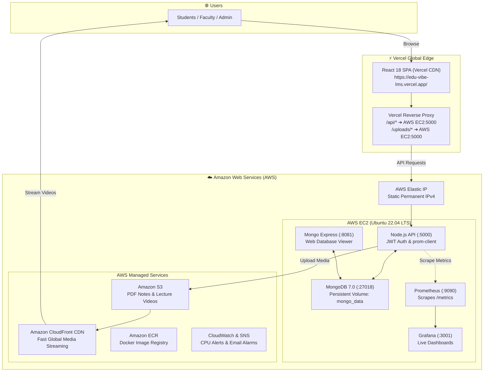
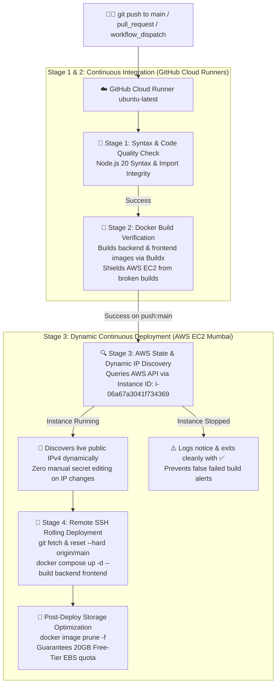

<p align="center">
  
</p>

# 🎓 EduVibe - Next-Gen Academic & Learning Management Portal

[](https://edu-vibe-lms.vercel.app/)
[](https://aws.amazon.com/)
[](https://www.terraform.io/)
[](https://www.docker.com/)
[](https://react.dev/)
[](https://nodejs.org/)
[](https://www.mongodb.com/)
[](https://prometheus.io/)

---

## 🚀 View Live Site

[](https://edu-vibe-lms.vercel.app/)
[](https://github.com/ajaygangwar945/EduVibe-LMS/actions/workflows/deploy.yml)

🔗 **[Live Web Portal](https://edu-vibe-lms.vercel.app/)** • ⚡ **[Live Backend API (Render)](https://eduvibe-lms-backend-api.onrender.com/api/health)**

---

## 📌 Project Overview

**EduVibe** is a modern, full-stack Academic & Learning Management Portal built with **React 18**, **Node.js**, **Express**, and **MongoDB 7.0**. It simplifies academic operations with three role-based dashboards:

- 👨‍🎓 **Students**: Watch lecture videos, download notes, take auto-graded quizzes, submit assignments, and track attendance (with 75% minimum warning alerts).
- 👩‍🏫 **Faculty**: Create courses, upload syllabus PDFs and video lectures, record daily attendance, create timed quizzes, and grade homework.
- 🛡️ **Admin**: Review analytics KPIs, approve new faculty registrations, and manage all users.

The frontend is served globally via **Vercel Edge**, while the backend, database, and telemetry run on **AWS EC2** provisioned automatically with **Terraform**.

> 📖 **Full Engineering Details**: See [`documentation.txt`](documentation.txt) for the complete architecture guide and step-by-step build manual.

---

## 🌐 Live Project Endpoints

| Service | Provider | URL | Notes |
| :--- | :--- | :--- | :--- |
| 🎓 **Live Web Portal** | **Vercel** | [https://edu-vibe-lms.vercel.app/](https://edu-vibe-lms.vercel.app/) | Production React SPA (Global Edge) |
| ⚡ **Live Production API** | **Render** | [https://eduvibe-lms-backend-api.onrender.com/api/health](https://eduvibe-lms-backend-api.onrender.com/api/health) | 24/7 Live PaaS API + Resend OTP Email |
| ☁️ **AWS Backend API** | **AWS EC2** | `http://<YOUR_AWS_PUBLIC_IP>:5000/api/health` | Containerized Express API on EC2 |
| 📊 **Prometheus Metrics**| **Render / AWS** | `https://eduvibe-lms-backend-api.onrender.com/metrics` | Real-time API telemetry metrics |
| 📈 **Grafana Dashboard** | **AWS EC2** | `http://<YOUR_AWS_PUBLIC_IP>:3001` | Live performance telemetry dashboard |

> *(For AWS endpoints, replace `<YOUR_AWS_PUBLIC_IP>` with your live EC2 Public IP or run `terraform output`).*

---

## 🏗️ System Architecture



### How It Works:
1. **Frontend Delivery**: Vercel serves the React SPA globally with zero latency.
2. **Smart API Routing**: `frontend/vercel.json` proxies all `/api/*` and `/uploads/*` requests to our AWS Elastic IP on port 5000. This completely avoids CORS and mixed-content issues.
3. **Authentication**: Passwords are encrypted with Bcrypt. Logins return a signed JSON Web Token (JWT) that authorizes role-based dashboard access.
4. **Media Streaming**: Lecture notes and videos upload to S3 and stream worldwide through Amazon CloudFront CDN.
5. **Monitoring**: Node.js exports `/metrics`, Prometheus collects them every 5s, and Grafana displays live visual charts.

---

## ☁️ AWS Cloud Services Used

| Service | Resource Name | What It Does In This Project |
| :--- | :--- | :--- |
| **1. Amazon EC2** | `aws_instance.eduvibe_server` | Runs the Docker engine with our API, MongoDB, and monitoring containers on Ubuntu 22.04 LTS (`t2.micro`). |
| **2. AWS Elastic IP** | `aws_eip.eduvibe_eip` | Provides a permanent static public IP so server restarts never break Vercel's proxy connection. |
| **3. Amazon S3** | `aws_s3_bucket.eduvibe_storage` | Secure cloud storage for lecture PDFs and videos with AES-256 encryption. |
| **4. Amazon CloudFront** | `aws_cloudfront_distribution.s3_distribution` | High-speed global CDN that caches and streams videos/PDFs with low latency. |
| **5. Amazon ECR** | `aws_ecr_repository` | Private Docker registry to store versioned images for automated deployments. |
| **6. Amazon CloudWatch** | `aws_cloudwatch_metric_alarm` | Monitors server health and triggers an alarm if CPU usage exceeds 85%. |
| **7. Amazon SNS** | `aws_sns_topic.alerts` | Sends instant alert emails to administrators when CloudWatch alarms trigger. |
| **8. AWS IAM & Security Groups** | `aws_security_group.eduvibe_sg` | Manages least-privilege cloud permissions and acts as a firewall for open ports (80, 5000, 8081, 9090, 3001, 22). |

---

## 🔄 CI/CD Automation: GitHub Actions Pipeline

EduVibe features an automated, production-grade **GitHub Actions CI/CD Pipeline** ([`.github/workflows/deploy.yml`](.github/workflows/deploy.yml)) providing automated testing, container build validation, dynamic AWS EC2 state & IP discovery, and zero-downtime rolling deployment on every `git push`.



### Detailed Pipeline Architecture & Stage Analysis:

| Stage # | Stage Name | Execution Environment | Core Responsibilities & Protections |
| :--- | :--- | :--- | :--- |
| **Stage 1** | `test-and-lint` | `ubuntu-latest` (GitHub Cloud) | • Checks out repository via `actions/checkout@v4`<br/>• Sets up Node.js 20 environment<br/>• Executes backend syntax & import verification<br/>• Fails instantly on broken commits before any compute/build runs |
| **Stage 2** | `build-containers` | `ubuntu-latest` (GitHub Cloud) | • Initializes `docker/setup-buildx-action@v3`<br/>• Tests compilation of `eduvibe-backend` & `eduvibe-frontend` Docker images<br/>• Offloads compilation overhead (CPU & RAM) completely off the EC2 instance<br/>• Ensures container artifacts build cleanly without pushing unverified images |
| **Stage 3** | `deploy-to-ec2` (Discovery) | `ubuntu-latest` (GitHub Cloud) | • Authenticates via `aws-actions/configure-aws-credentials@v4`<br/>• Discovers live EC2 state and public IP address dynamically via AWS CLI<br/>• Gracefully handles stopped instances (exits cleanly without failure flags) |
| **Stage 4** | `deploy-to-ec2` (Deploy) | AWS EC2 Mumbai (`ap-south-1`) | • Remote execution via `appleboy/ssh-action@v1.0.3` using `webserver.pem`<br/>• Atomic Git synchronization (`git reset --hard origin/main`)<br/>• Rebuilds and relaunches containers (`docker compose up -d --build`)<br/>• Runs `docker image prune -f` to maintain Free-Tier disk quotas |

---

### 💡 Solving the AWS EC2 Dynamic IP Challenge

> **The Problem:** In the AWS EC2 Free Tier, stopping and restarting an EC2 instance deallocates its standard public IPv4 address and assigns a brand-new random IP. In traditional CI/CD pipelines, hardcoding the IP in repository secrets causes deployments to fail immediately after any server reboot or maintenance cycle.

> **EduVibe's Automated Solution:** EduVibe leverages **Dynamic AWS EC2 IP & State Discovery**. Instead of hardcoding the IP, GitHub Actions uses the persistent AWS Instance ID (`i-06a67a3041f734369`) or project tag (`Name=eduvibe-cloud-server`) to query the AWS Cloud API in real time:
> ```bash
> # Dynamically resolve fresh public IPv4 from AWS Cloud at runtime
> NEW_IP=$(aws ec2 describe-instances --instance-ids ${{ secrets.EC2_INSTANCE_ID }} \
>   --query "Reservations[0].Instances[0].PublicIpAddress" --output text)
> ```
> - **Server Stopped?** The workflow logs `⚠️ EC2 instance is currently stopped. Skipping deployment safely.` and terminates with status code `0` (green checkmark `✅`), avoiding false failure alerts.
> - **New IP Assigned?** The workflow dynamically injects the fresh IP into `steps.ec2-discover.outputs.public_ip` and connects via SSH with zero manual intervention or secret edits!

---

### ⚖️ Architectural Decision: Why GitHub Actions Replaced Jenkins

EduVibe previously evaluated a self-hosted Jenkins server and decisively migrated to **GitHub Actions Cloud**:

| Architectural Dimension | Traditional Jenkins (Self-Hosted) | EduVibe GitHub Actions (Cloud-Native) |
| :--- | :--- | :--- |
| **EC2 Host Memory Footprint** | Consumes **~1,000 MB+ RAM** (Java JVM runtime). Causes Linux kernel Out-Of-Memory (OOM) crashes on AWS `t2.micro` (1 GB total RAM). | **0 MB host RAM consumed**. Workloads execute 100% on GitHub's hosted runners (2 vCPU, 7 GB RAM). |
| **Financial Cost** | Requires dedicated EC2 compute running 24/7 (~$15-$25/month) or crowds out application workloads. | **$0.00 billable cost** (2,000 free runner minutes/month for private repositories, unlimited for public). |
| **Attack Surface & Security** | Requires opening public port `8080` to the internet, exposing the server to web exploits and brute-force attacks. | **Zero open ports required**. GitHub Actions initiates an outbound SSH session directly using encrypted RSA/Ed25519 keys. |
| **Maintenance Overhead** | Constant Jenkins core updates, plugin dependency hell, and disk volume management. | **Zero maintenance**. Managed runner environments, automatic action versioning, and zero server patching. |
| **Failure Isolation** | Broken builds crash the host server's memory and CPU, degrading live student/faculty traffic. | **100% isolated**. Faulty builds fail inside ephemeral GitHub Cloud runners, never touching the AWS EC2 server. |

---

### 🔐 Required GitHub Secrets:
Configure these under **GitHub Repository ➔ Settings ➔ Secrets and variables ➔ Actions**:

| Secret Name | Description & Purpose | Value Source |
| :--- | :--- | :--- |
| `AWS_ACCESS_KEY_ID` | IAM programmatic access key for AWS CLI queries | AWS IAM user `aws-cli-user` |
| `AWS_SECRET_ACCESS_KEY` | IAM secret access key | AWS IAM user `aws-cli-user` |
| `AWS_REGION` | AWS Region where EduVibe EC2 instance is hosted | `ap-south-1` (Mumbai) |
| `EC2_INSTANCE_ID` | Persistent AWS Instance ID (never changes across restarts) | `i-06a67a3041f734369` |
| `EC2_SSH_KEY` | Full private RSA key (`.pem`) for SSH remote execution | Content of `C:\Users\ajayg\.ssh\webserver.pem` |

---

### 🚀 Triggering & Monitoring the Pipeline:

1. **Automatic Push Trigger:**
   ```bash
   git add .
   git commit -m "feat: enhance course attendance module"
   git push origin main
   ```
   *GitHub Actions automatically runs Stage 1 (Lint) ➔ Stage 2 (Docker Build) ➔ Stage 3 (EC2 Deploy).*

2. **Manual Web Trigger (`workflow_dispatch`):**
   - Go to your repository on GitHub.
   - Click the **Actions** tab ➔ Select **EduVibe CI/CD Pipeline**.
   - Click **Run workflow** ➔ Select branch `main` ➔ Click **Run workflow**.

3. **Inspect Real-Time Logs:**
   - Click on the active workflow run to view live step logs, discovered IP addresses, and container restart output.

---

## 🚀 Four Ways to Run & Deploy

```text
┌─────────────────────────────────────────────────────────────────────────────────────────┐
│                              CHOOSE YOUR DEPLOYMENT METHOD                              │
├─────────────────────┬──────────────────────┬──────────────────────┬─────────────────────┤
│ 1. Local Dev (npm)  │ 2. Docker Compose    │ 3. AWS + Vercel      │ 4. Vercel + Render  │
├─────────────────────┼──────────────────────┼──────────────────────┼─────────────────────┤
│ • Fast hot reload   │ • 1-command startup  │ • AWS EC2 t2.micro   │ • Live 24/7 online  │
│ • Vite + Nodemon    │ • Runs all tools     │ • Terraform IaC      │ • $0.00 permanent   │
│ • Local Mongo DB    │ • Persistent volumes │ • GitHub Actions CD  │ • Resend Real OTP   │
└─────────────────────┴──────────────────────┴──────────────────────┴─────────────────────┘
```

---

### 💻 Method 1: Local Development (Bare-Metal / npm)

Best for active coding and quick testing with instant hot reload.

#### 1. Start MongoDB
Make sure MongoDB is running on your machine (Port `27017`), or run:
```bash
docker compose up -d mongo
```

#### 2. Start Backend API (Terminal 1)
```powershell
cd backend
npm install
npm run dev
```
*Backend runs on `http://localhost:5000` (connects to MongoDB).*

#### 3. Start Frontend (Terminal 2)
```powershell
cd frontend
npm install
npm run dev
```
*Open `http://localhost:5173` in your browser (Vite automatically proxies API calls to port 5000).*

---

### 🐳 Method 2: Docker Container Deployment (Docker Compose)

Best for running the complete isolated stack in one simple command.

```bash
# Start core application (Frontend, Backend, MongoDB, Mongo Express):
docker compose up -d

# OR Start application + Prometheus & Grafana monitoring:
docker compose --profile monitoring up -d
```

**Local Docker URLs:**
- 🎓 **Web Portal**: [http://localhost:3005](http://localhost:3005)
- 🔌 **Backend API**: [http://localhost:5000/api/health](http://localhost:5000/api/health)
- 🍃 **MongoDB GUI**: [http://localhost:8081](http://localhost:8081)
- 📊 **Prometheus**: [http://localhost:9090](http://localhost:9090)
- 📈 **Grafana**: [http://localhost:3001](http://localhost:3001)

```bash
# To stop containers (data is saved in Docker volumes):
docker compose --profile monitoring down
```

---

### ☁️ Method 3: Cloud Production Deployment (AWS + Vercel + GitHub Actions)

Streamlined cloud deployment combining Vercel's global CDN with AWS EC2 and automated GitHub Actions CI/CD.

#### Step 1: Provision Streamlined AWS Cloud Infrastructure with Terraform (<45s)
```bash
cd devops/terraform
terraform init
terraform apply -auto-approve
terraform output
```
*Provisions AWS EC2 (`t2.micro`), Security Group, and IAM Instance Profile adhering strictly to AWS Free Tier ($0.00 cost).*

#### Step 2: Deploy Frontend on Vercel
1. Import repository to Vercel (Root Directory: `frontend`, Preset: `Vite`).
2. `frontend/vercel.json` automatically routes `/api/*` and `/uploads/*` to the EC2 backend.
3. Access live: **[https://edu-vibe-lms.vercel.app/](https://edu-vibe-lms.vercel.app/)**

#### Step 3: Automated Continuous Deployment (GitHub Actions)
Whenever you push changes to `main`:
```bash
git push origin main
```
*GitHub Actions automatically runs code quality tests, builds Docker images in the cloud, dynamically queries your live EC2 IP, and updates containers on EC2 with zero downtime.*

#### Step 4: Manual SSH Access & Diagnostics (Optional)
```bash
ssh -i ~/.ssh/webserver.pem ubuntu@<YOUR_AWS_PUBLIC_IP>
docker ps                                             # Inspect running containers
curl http://localhost:5000/api/health                 # Verify API health
```

#### Cost Protection ($0 / Free Tier):
- Pause server when not in use: `aws ec2 stop-instances --instance-ids i-06a67a3041f734369`
- Destroy cloud resources when finished: `cd devops/terraform && terraform destroy -auto-approve`

---

### 🌐 Method 4: Production Cloud Tier (Vercel + Render + MongoDB Atlas)

Live, permanent production deployment with **$0.00 infrastructure cost** and zero virtual machine maintenance.

#### Active Production Architecture:
- **Frontend:** Vercel Global Edge CDN ([https://edu-vibe-lms.vercel.app/](https://edu-vibe-lms.vercel.app/))
- **Backend API:** Render Docker Web Service ([https://eduvibe-lms-backend-api.onrender.com/](https://eduvibe-lms-backend-api.onrender.com/))
- **Email Service:** Resend Cloud Transactional API (delivers 6-digit OTPs in real time)
- **Database:** MongoDB Atlas M0 Cloud Replica Set (`cluster0.0xjeu.mongodb.net`)

#### Quick Live Verification:
```powershell
# 1. Check API Health
Invoke-RestMethod -Uri "https://eduvibe-lms-backend-api.onrender.com/api/health"

# 2. Test Real Email OTP Delivery
$payload = @{ email = "ajaygangwar945@gmail.com"; purpose = "password_reset" } | ConvertTo-Json
Invoke-RestMethod -Uri "https://eduvibe-lms-backend-api.onrender.com/api/auth/send-otp" `
  -Method Post -Body $payload -ContentType "application/json"
```

---

## 🔑 Default Demo Accounts

The database comes pre-seeded with test accounts:

| Role | Email | Password | Access Capabilities |
| :--- | :--- | :--- | :--- |
| **System Admin** | `admin@eduvibe.com` | `admin123` | Approve faculty, manage users, view system KPIs |
| **Faculty** | `robert.smith@eduvibe.com` | `password123` | Create courses, mark attendance, upload videos/notes, create quizzes |
| **Student** | *(Self-Register)* | *(Your Password)* | Click **Register as Student** on login page (gets ID `STU-2026-XXXX`) |
| **Mongo Express GUI** | `http://<YOUR_AWS_ELASTIC_IP>:8081` | `admin` | *(Configured in `.env`)* |
| **Grafana Analytics** | `http://<YOUR_AWS_ELASTIC_IP>:3001` | `admin` | *(Configured in `.env`)* |

---

## 📁 Repository Structure

```text
EduVibe/
├── assets/
│   └── eduvibe-banner.jpg      # Custom AI-generated hero banner image
│
├── frontend/                   # React 18 Frontend (Vite)
│   ├── src/
│   │   ├── pages/             # Login, Student, Faculty & Admin Dashboards
│   │   ├── context/           # AuthContext (JWT session management)
│   │   ├── App.jsx            # Protected routes & app layout
│   │   └── index.css          # Glassmorphism design tokens & styles
│   ├── vercel.json            # Vercel deployment & API reverse-proxy rewrites
│   ├── Dockerfile             # Multi-stage Nginx container build
│   └── nginx.conf             # Nginx reverse proxy config
│
├── backend/                    # Node.js Express Backend
│   ├── models/                # User, Course, Attendance, Quiz, Assignment
│   ├── routes/                # auth.js, student.js, faculty.js, admin.js
│   ├── middleware/            # JWT verification & Multer file uploads
│   ├── server.js              # Express app + /metrics Prometheus endpoint
│   ├── Dockerfile             # Lightweight Node.js Alpine container
│   └── uploads/               # Persistent uploaded PDFs and videos
│
├── .github/
│   └── workflows/
│       └── deploy.yml         # GitHub Actions CI/CD with Dynamic EC2 IP Discovery
│
├── devops/
│   ├── terraform/             # AWS Infrastructure as Code (EC2, S3, CloudFront, ECR, IAM)
│   ├── k8s/                   # Kubernetes manifests (Deployments, Services, PVC)
│   └── monitoring/            # Prometheus scrape config & Grafana dashboards
│
├── .dockerignore              # Docker build exclusions
├── .gitignore                 # Git ignore rules for secrets and node_modules
├── docker-compose.yml         # Main root multi-container configuration
├── documentation.txt          # Complete in-depth technical manual & engineering guide
└── README.md                  # Main project overview & quickstart guide
```

---

## 👤 Author & Academic Details

- **Ajay Gangwar** - [GitHub Profile](https://github.com/ajaygangwar945)
- **Project**: EduVibe - Next-Gen Academic & Learning Management Portal
- **Course**: INT 377 - Cloud & DevOps Architecture (SEM 6)
