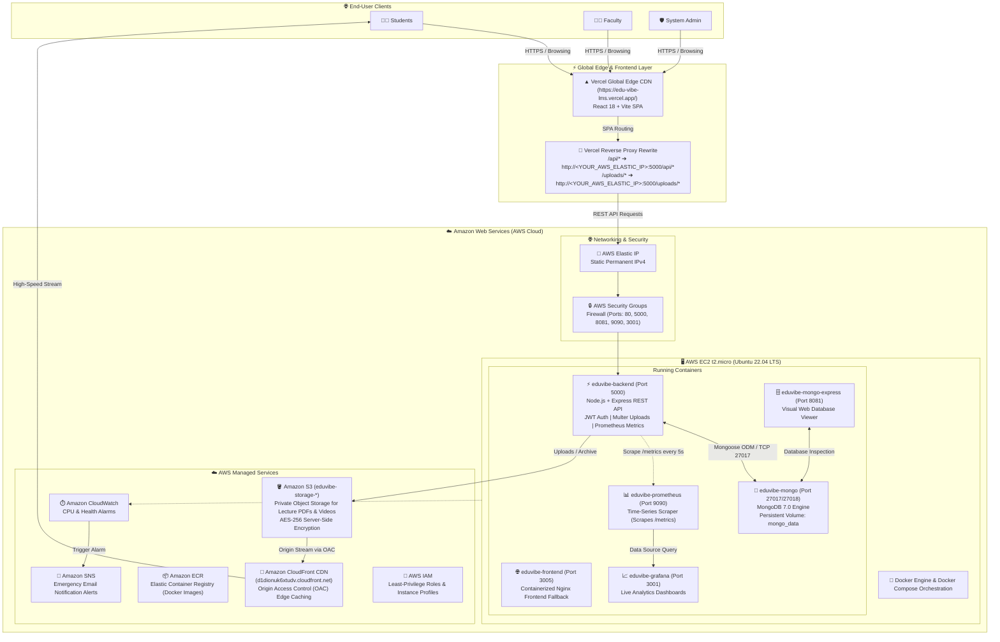

# 🎓 EduVibe - Next-Gen Academic & Learning Management Portal

[](https://edu-vibe-lms.vercel.app/)
[](https://aws.amazon.com/)
[](https://www.terraform.io/)
[](https://www.docker.com/)
[](https://react.dev/)
[](https://nodejs.org/)
[](https://www.mongodb.com/)
[](https://prometheus.io/)

---

## 🚀 View Live Site
The project is live and accessible online.

🔗 [Live Website](https://edu-vibe-lms.vercel.app/)

---

## 📌 Executive Summary

**EduVibe** is an enterprise-grade, full-stack Academic & Learning Management Portal engineered for higher-education institutions. Built using modern web technologies (**React 18, Vite, Node.js, Express, MongoDB 7.0**), EduVibe provides secure, tailored digital workflows for three primary academic roles: **Students**, **Faculty**, and **Institutional Administrators**.

The platform features seamless in-browser video lecture streaming, instant PDF study material previews, interactive auto-graded quizzes, daily attendance monitoring with regulatory 75% threshold alerts, and student assignment evaluation workflows.

EduVibe is designed with cloud-native DevOps principles: infrastructure is codified via **Terraform (IaC)**, deployed on **AWS** within the AWS Free Tier, continuously built through **Jenkins CI/CD**, monitored with **Prometheus and Grafana**, and served globally with ultra-low latency through **Vercel Edge** and **Amazon CloudFront CDN**.

---

## 🌐 Live Project Links & Endpoints

| Resource | Service Provider | Live Access URL | Description |
| :--- | :--- | :--- | :--- |
| 🚀 **Live Web Portal** | **Vercel Global Edge** | [https://edu-vibe-lms.vercel.app/](https://edu-vibe-lms.vercel.app/) | Production React SPA web portal |
| ⚡ **Backend API Health** | **AWS EC2 (Elastic IP)** | `http://<YOUR_AWS_ELASTIC_IP>:5000/api/health` | Node.js REST API health check endpoint |
| 🎬 **Media CDN Stream** | **Amazon CloudFront** | `https://d1dionuk6xtudv.cloudfront.net` | Global high-speed CDN for video lectures & PDFs |
| 🍃 **Database Web GUI** | **AWS EC2 (Docker)** | `http://<YOUR_AWS_ELASTIC_IP>:8081` | Mongo Express visual database browser |
| 📊 **Prometheus Metrics** | **AWS EC2 (Docker)** | `http://<YOUR_AWS_ELASTIC_IP>:9090` | Real-time metric scrape target explorer |
| 📈 **Grafana Analytics** | **AWS EC2 (Docker)** | `http://<YOUR_AWS_ELASTIC_IP>:3001` | Live telemetry & API latency dashboards |

> [!NOTE]
> For security best practices, the AWS Public Elastic IP is masked as `<YOUR_AWS_ELASTIC_IP>` in this public documentation. Replace it with your allocated AWS Elastic IP when connecting directly to backend or telemetry services.

---

## 🏗️ System Architecture

EduVibe employs a **hybrid cloud, micro-services container architecture**. The frontend is deployed to Vercel's global edge network, while backend APIs, database persistence, and observability services run containerized on an Amazon Web Services (AWS) EC2 virtual machine managed via Terraform.

### Visual Architecture Flowchart



---

## ⚙️ How the System Works (End-to-End Workflow)

The architecture is divided into decoupled operational tiers to guarantee low latency, robust data isolation, and resilient high availability:

### 1. Request Routing & API Reverse Proxying
- When a user accesses **[https://edu-vibe-lms.vercel.app/](https://edu-vibe-lms.vercel.app/)**, Vercel’s global Edge network delivers the optimized, minified React 18 single-page application from the closest geographical edge point.
- When the frontend performs REST API requests (e.g. `/api/auth/login`, `/api/student/dashboard`), `vercel.json` rewrites and proxies traffic directly to the permanent **AWS Elastic IP** (`http://<YOUR_AWS_ELASTIC_IP>:5000`).
- **Eliminating CORS & Mixed-Content**: The reverse proxy eliminates Cross-Origin Resource Sharing (CORS) friction and prevents browser mixed-content warnings by masking backend origin calls behind standard relative paths.

### 2. Role-Based Access Control (RBAC) & Authentication Flow
- All passwords are encrypted using **Bcrypt** (salt rounds: 10) before storage in MongoDB.
- Upon successful authentication, the backend generates a signed **JSON Web Token (JWT)** containing the user's unique ID, email, and role (`student`, `faculty`, or `admin`).
- The client stores the JWT in local storage and includes an `Authorization: Bearer <token>` header with every outgoing request.
- Express middleware intercepts requests, validates the cryptographic token signature, enforces role boundaries, and rejects unauthorized access with HTTP 403 Forbidden.

### 3. Course Management & Media Streaming Flow
- **Course Creation & File Uploads**: A faculty member creates a subject and uploads syllabus materials (PDF) or recorded video lectures (`.mp4`, `.webm`).
- **Sanitization & Multer Pipeline**: File uploads pass through strict Multer middleware validating file signatures and MIME types, sanitizing filenames, and writing them to persistent storage volumes.
- **S3 & CloudFront Edge Distribution**: Assets sync with Amazon S3 (`eduvibe-storage-*`). When students stream videos or view lecture notes, requests route through **Amazon CloudFront CDN** (`d1dionuk6xtudv.cloudfront.net`) using Origin Access Control (OAC), providing buffered, low-latency playback worldwide without exposing the S3 bucket to public writes.

### 4. Academic Evaluation & Operations
- **Quizzes & Automated Grading**: Faculty create timed quizzes with dynamic question counts and point values. When a student submits answers, the server automatically computes scores in real time, records the submission in MongoDB, and displays instant feedback.
- **Daily Attendance Tracker**: Faculty select a subject, choose the date, and mark student presence. The student dashboard instantly renders attendance metrics with a dynamic visual gauge (flagging attendance below the mandatory 75% requirement in amber/red).
- **Assignments**: Students submit PDF documents which faculty can download, grade, and annotate with feedback directly from the faculty console.

### 5. Observability & Telemetry Pipeline
- The Express application instruments endpoints using `prom-client`, exposing a `/metrics` feed capturing request count, response duration percentiles, error rates, and system heap memory.
- **Prometheus** scrapes the backend every 5 seconds.
- **Grafana** connects to Prometheus as a data source, rendering visual dashboards for CPU usage, memory consumption, active HTTP traffic, and API response latencies.

---

## ☁️ AWS Cloud Services Breakdown

EduVibe utilizes 8 native AWS services architected to maximize efficiency, performance, and security while remaining strictly within the **AWS Free Tier ($0/month)**:

| AWS Service | Exact Resource Identifier | Role & Architectural Purpose in EduVibe |
| :--- | :--- | :--- |
| **1. Amazon EC2** *(Elastic Compute Cloud)* | `aws_instance.eduvibe_server`<br/>(`t2.micro`, Ubuntu 22.04 LTS) | Hosts the Docker virtualization runtime executing our backend API, MongoDB database, visual database explorer, Prometheus, and Grafana containers. Configured with a 30 GB EBS gp3 encrypted root volume. |
| **2. AWS Elastic IP** *(EIP)* | `aws_eip.eduvibe_eip`<br/>(Allocated static IPv4) | Provides a permanent, immutable public IPv4 address attached to our EC2 instance. Guarantees that server restarts, redeployments, or updates never break Vercel API proxy routing or external DNS records. |
| **3. Amazon S3** *(Simple Storage Service)* | `aws_s3_bucket.eduvibe_storage`<br/>(`eduvibe-storage-*`) | Enterprise cloud object store for educational media (PDF syllabus notes, student assignment files, lecture video recordings). Enforces AES-256 server-side encryption at rest and strict Public Access Block. |
| **4. Amazon CloudFront** | `aws_cloudfront_distribution.s3_distribution`<br/>(`d1dionuk6xtudv.cloudfront.net`) | Global Content Delivery Network (CDN) caching lecture videos and PDFs across 400+ worldwide Edge locations. Uses Origin Access Control (OAC) with AWS SigV4 to safely stream media with minimal buffering. |
| **5. Amazon ECR** *(Elastic Container Registry)* | `aws_ecr_repository.backend_repo`<br/>`aws_ecr_repository.frontend_repo` | Private Docker container image registry storing versioned container builds. Integrates with the CI/CD pipeline to push scanned container artifacts before production deployment. |
| **6. Amazon CloudWatch** | `aws_cloudwatch_metric_alarm.high_cpu` | Continuously monitors EC2 system health, hypervisor status checks, and compute utilization. Configured with a CloudWatch alarm that trips when CPU utilization exceeds 85% for two consecutive evaluation periods. |
| **7. Amazon SNS** *(Simple Notification Service)* | `aws_sns_topic.alerts`<br/>(`eduvibe-alarms`) | Real-time push notification topic connected to CloudWatch. Automatically dispatches immediate emergency alert emails to system administrators whenever system thresholds are breached. |
| **8. AWS IAM & Security Groups** | `aws_iam_role.ec2_role`<br/>`aws_security_group.eduvibe_sg` | Enforces defense-in-depth: IAM provides least-privilege instance profile permissions for S3/CloudWatch without hardcoded keys. Security Groups act as a stateful firewall controlling inbound access on explicit ports (22, 80, 5000, 8081, 9090, 3001). |

---

## 🚀 Three Deployment Methods

EduVibe is designed with full deployment flexibility. Choose the method that best fits your environment:

```text
┌─────────────────────────────────────────────────────────────────────────────┐
│                       CHOOSE YOUR DEPLOYMENT PATH                           │
├──────────────────────┬──────────────────────┬───────────────────────────────┤
│ Option 1: Local Dev  │ Option 2: Docker     │ Option 3: AWS Cloud + Vercel  │
│ (Bare-Metal / npm)   │ (Single-Host Stack)  │ (Production Hybrid Cloud)     │
├──────────────────────┼──────────────────────┼───────────────────────────────┤
│ • Best for rapid dev │ • 1-click execution  │ • Live production deployment  │
│ • Hot code reload    │ • Zero dependency    │ • Globally distributed CDN    │
│ • Vite + Nodemon     │ • Full isolation     │ • Terraform IaC automation    │
│ • Local Mongo/Tools  │ • Compose profiles   │ • Permanent AWS Elastic IP    │
└──────────────────────┴──────────────────────┴───────────────────────────────┘
```

---

### 💻 Method 1: Local Development Deployment (Bare-Metal / npm)

*Ideal for development, debugging, and UI iteration with instant hot-reloading.*

#### 1. Prerequisites
- **Node.js** (v18.x or v20.x LTS) & **npm**
- **MongoDB** running locally on Windows (Port `27017`) or via Docker (`docker compose up -d mongo`)
- *(Optional)* **MongoDB Compass** for visual database browsing
- *(Optional)* **Prometheus & Grafana** installed locally for metrics testing

#### 2. Environment Configuration
Create or verify `server/.env`:
```env
PORT=5000
MONGO_URI=mongodb://127.0.0.1:27017/eduvibe
JWT_SECRET=eduvibe_local_super_secret_development_key_2026
ADMIN_EMAIL=admin@eduvibe.com
ADMIN_PASSWORD=admin123
CLIENT_URL=http://localhost:5173
```

#### 3. Start Local MongoDB
- Ensure the **MongoDB Server** service is running in Windows Services, or launch it via MongoDB Compass.
- Alternatively, launch only the MongoDB container with Docker:
  ```bash
  docker compose up -d mongo
  ```

#### 4. Run the Backend API (Terminal 1)
```powershell
# Navigate to backend directory
cd server

# Install dependencies
npm install

# Run backend with nodemon hot-reload
npm run dev
```
**Expected Output:**
```text
🚀 EduVibe Backend running on port 5000
[Database] MongoDB connected successfully to mongodb://127.0.0.1:27017/eduvibe
[Seed] Default Admin account verified/created (admin@eduvibe.com)
```

#### 5. Run the React Frontend (Terminal 2)
```powershell
# Navigate to frontend directory
cd client

# Install dependencies
npm install

# Start Vite dev server
npm run dev
```
**Expected Output:**
```text
  VITE v5.x.x  ready in 320 ms

  ➜  Local:   http://localhost:5173/
  ➜  Network: use --host to expose
```
Open **[http://localhost:5173](http://localhost:5173)** in your browser. Vite automatically proxies `/api` and `/uploads` requests directly to `http://localhost:5000`.

#### 6. Database Inspection via MongoDB Compass
1. Launch **MongoDB Compass**.
2. Connect to URI: `mongodb://localhost:27017/`
3. Click on the **`eduvibe`** database to view collections: `users`, `courses`, `quizzes`, `attendances`, `assignments`.

#### 7. Local Monitoring with Prometheus & Grafana (Optional)
1. Add the target to your local `C:\Prometheus\prometheus.yml`:
   ```yaml
   scrape_configs:
     - job_name: "eduvibe-backend-local"
       scrape_interval: 5s
       metrics_path: "/metrics"
       static_configs:
         - targets: ["localhost:5000"]
   ```
2. Start Prometheus:
   ```powershell
   cd C:\Prometheus
   .\prometheus.exe --config.file=prometheus.yml
   ```
3. Open Grafana at **[http://localhost:3000](http://localhost:3000)** and configure Prometheus (`http://localhost:9090`) as the data source.

#### 8. Stopping Local Development
Press `Ctrl + C` in both the backend and frontend terminal windows.

---

### 🐳 Method 2: Docker Container Deployment (Docker Compose)

*Ideal for testing the full production-like containerized stack on any machine with zero manual runtime installation.*

#### 1. Prerequisites
- **Docker Desktop** installed and running on Windows, macOS, or Linux.

#### 2. Start Application Containers

From the project root directory:

- **Option A: Core Application Only** (Frontend, Backend, MongoDB, Mongo Express):
  ```bash
  docker compose up -d
  ```

- **Option B: Application + Complete Monitoring Stack** (Includes Prometheus & Grafana):
  ```bash
  docker compose --profile monitoring up -d
  ```

#### 3. Container Services & Port Allocation

| Container Name | Internal Service | Host Port | Description |
| :--- | :--- | :--- | :--- |
| `eduvibe-frontend` | React SPA (Nginx) | `http://localhost:3005` | Containerized web portal |
| `eduvibe-backend` | Node.js Express API | `http://localhost:5000` | REST API engine & `/metrics` |
| `eduvibe-mongo` | MongoDB 7.0 Server | `127.0.0.1:27018` | Core database engine (loopback) |
| `eduvibe-mongo-express` | Database Web Viewer | `http://localhost:8081` | Web-based MongoDB GUI |
| `eduvibe-prometheus` | Prometheus Scraper | `http://localhost:9090` | Time-series telemetry scraper |
| `eduvibe-grafana` | Grafana Analytics | `http://localhost:3001` | Live dashboard visualizer |

#### 4. Persistent Volumes & Data Safety
Docker Compose uses named volumes to ensure zero data loss across restarts:
- `mongo_data` ➔ Preserves all student records, faculty courses, and attendance logs.
- `uploads_data` ➔ Preserves all uploaded PDFs, assignment submissions, and video files.

#### 5. Docker Command Cheat Sheet

```bash
# View active container status & health
docker ps

# Stream live unified logs
docker compose logs -f

# Stream logs for backend only
docker compose logs -f backend

# Rebuild containers after code changes
docker compose --profile monitoring up -d --build

# Pause all containers without removing them
docker compose --profile monitoring stop

# Resume paused containers
docker compose --profile monitoring start

# Cleanly stop and remove containers (data preserved in volumes)
docker compose --profile monitoring down

# Cleanly stop and wipe all persistent data (Caution: destructive)
docker compose --profile monitoring down -v
```

---

### ☁️ Method 3: Cloud Production Deployment (AWS + Vercel Hybrid)

*Our live production deployment combining Vercel's global CDN for the frontend with AWS enterprise infrastructure for backend compute, storage, and monitoring.*

#### 1. Part A: Provision AWS Infrastructure with Terraform
All cloud resources are codified in `devops/terraform/`:

```bash
# Navigate to Terraform directory
cd devops/terraform

# Initialize Terraform plugins & AWS provider
terraform init

# Validate syntax and view planned resource changes
terraform plan

# Apply configuration and provision infrastructure on AWS (~2 minutes)
terraform apply -auto-approve
```

Terraform automatically provisions:
1. VPC & Security Groups with port whitelisting.
2. IAM Roles & Instance Profiles for least-privilege cloud access.
3. Amazon S3 Bucket (`eduvibe-storage-*`) with AES-256 encryption.
4. Amazon CloudFront CDN Distribution with Origin Access Control (OAC).
5. Amazon ECR Repositories for Docker images.
6. Amazon EC2 `t2.micro` Ubuntu 22.04 LTS instance.
7. AWS Elastic IP attached to the EC2 instance.
8. Amazon CloudWatch Alarm + SNS Email Alert Topic.

#### 2. Part B: Deploy Frontend to Vercel
1. Link the repository to your [Vercel](https://vercel.com/) account.
2. Set Root Directory to `client`.
3. Framework Preset: **Vite**.
4. The file `client/vercel.json` automatically configures edge URL rewrites:
   ```json
   {
     "rewrites": [
       {
         "source": "/api/:path*",
         "destination": "http://<YOUR_AWS_ELASTIC_IP>:5000/api/:path*"
       },
       {
         "source": "/uploads/:path*",
         "destination": "http://<YOUR_AWS_ELASTIC_IP>:5000/uploads/:path*"
       },
       {
         "source": "/(.*)",
         "destination": "/index.html"
       }
     ]
   }
   ```
5. Deploy to generate your production URL: **[https://edu-vibe-lms.vercel.app/](https://edu-vibe-lms.vercel.app/)**.

#### 3. Part C: Configure & Launch Backend on AWS EC2
1. SSH into your newly provisioned AWS EC2 server:
   ```bash
   ssh -i <your-key.pem> ubuntu@<YOUR_AWS_ELASTIC_IP>
   ```
2. Clone the repository and configure environment variables:
   ```bash
   git clone https://github.com/ajaygangwar945/EduVibe-LMS.git
   cd EduVibe-LMS
   ```
3. Launch the container stack with Docker Compose:
   ```bash
   docker compose --profile monitoring up -d
   ```
4. Verify backend health:
   ```bash
   curl http://localhost:5000/api/health
   # Returns: {"status":"healthy","uptime":...,"timestamp":...}
   ```

#### 4. Part D: Automated CI/CD Pipeline (Jenkins)
The included `Jenkinsfile` automates testing and deployment:
1. **Checkout**: Pulls latest commit from GitHub `main` branch.
2. **Lint & Test**: Runs automated unit and security checks.
3. **Build Images**: Builds Docker images for `eduvibe-backend` and `eduvibe-frontend`.
4. **Push to ECR**: Authenticates and pushes versioned images to Amazon ECR.
5. **Rolling Deploy**: Triggers zero-downtime container updates on the EC2 host.

#### 5. Part E: Cost Management & Safe Cloud Teardown ($0 Protection)
To avoid unnecessary AWS charges outside active demonstration periods:
- **Temporary Pause**: Stop the EC2 instance via AWS Management Console or AWS CLI:
  ```bash
  aws ec2 stop-instances --instance-ids <YOUR_INSTANCE_ID>
  ```
- **Full Teardown**: Destroy all cloud infrastructure with 1 command:
  ```bash
  cd devops/terraform
  terraform destroy -auto-approve
  ```

---

## 🔑 Default Credentials & Test Accounts

The platform automatically seeds starter accounts for demonstration and evaluation:

| Portal Role | Access URL | Username / Email | Password | Permissions & Capabilities |
| :--- | :--- | :--- | :--- | :--- |
| **System Admin** | [https://edu-vibe-lms.vercel.app/](https://edu-vibe-lms.vercel.app/) | `admin@eduvibe.com` | `admin123` | Approve faculty registrations, manage all users, review institutional KPIs |
| **Faculty Member** | [https://edu-vibe-lms.vercel.app/](https://edu-vibe-lms.vercel.app/) | `robert.smith@eduvibe.com` | `password123` | Create courses, upload syllabus PDFs & lecture videos, mark daily attendance, create auto-graded quizzes |
| **Student** | [https://edu-vibe-lms.vercel.app/](https://edu-vibe-lms.vercel.app/) | *(Self-Register)* | *(Your Password)* | Click **Register as Student** on login page; automatically assigned roll number `STU-2026-XXXX` |
| **Mongo Express GUI** | `http://<YOUR_AWS_ELASTIC_IP>:8081` | `admin` | *(Configured in .env)* | Full visual web explorer for MongoDB collections |
| **Grafana Analytics** | `http://<YOUR_AWS_ELASTIC_IP>:3001` | `admin` | *(Configured in .env)* | Real-time monitoring dashboards and API latency metrics |

---

## 🎯 Key Role Features Matrix

### 👨‍🎓 Student Portal
- **Dashboard & Enrollment**: View personal profile, roll number, and enrolled courses.
- **Course Catalog**: Browse department subjects and enroll with 1 click.
- **In-Browser Video Streaming**: Stream lecture videos directly inside the browser with custom video controls.
- **PDF Notes & Syllabus**: Instant preview and download of study materials and lecture slides.
- **Interactive Quizzes**: Timed multiple-choice quizzes with instant auto-grading and score summaries.
- **Assignment Submissions**: Upload homework submissions in PDF format.
- **Attendance Tracker**: Visual gauge of overall attendance percentage with automatic alert warnings when falling below 75%.

### 👩‍🏫 Faculty Portal
- **Subject Management**: Create new courses and view enrolled student rosters.
- **Resource Uploads**: Upload syllabus documents (PDF) and video lectures (`.mp4`, `.webm`).
- **Daily Attendance Marking**: Select subject and date, toggle student presence, and save with 1 click.
- **Quiz Builder**: Create custom quizzes with timers, questions, options, and points.
- **Assignment Evaluation**: Download student PDF submissions, assign marks, and post feedback.

### 🛡️ Admin Console
- **System KPIs**: Real-time counter of total students, active faculty, and courses.
- **Faculty Approval Workflow**: 1-click approval that generates official Registration Numbers (e.g. `FAC-2026-XXXX`) and activates accounts.
- **User Directory**: Search and filter all registered students and teachers.
- **Institutional Reports**: Summaries of enrollment and course resources.

---

## 🔒 Security & DevSecOps Best Practices

EduVibe is engineered with enterprise security best practices:
- **NoSQL Injection Defense**: Strict type checking and string coercion prevents query operator injection attacks.
- **Brute-Force Rate Limiting**: In-memory rate limiter on authentication endpoints stops dictionary and credential stuffing attacks.
- **IDOR Protection**: Object-level access control guarantees faculty can only grade, modify, or upload to subjects they teach.
- **Strict File Upload Sanitization**: Double-checked MIME type and extension whitelist (`.pdf`, `.docx`, `.mp4`, etc.) with randomized filenames to eliminate remote code execution (RCE).
- **Container Hardening**: Node.js backend runs under unprivileged non-root user `node` in Docker; sensitive files (`.env`, `*.key`, `*.pem`) are barred via `.dockerignore`.
- **AWS Infrastructure Security**:
  - Permanent Elastic IP (`aws_eip`) ensures stable zero-friction access across reboots.
  - S3 bucket blocks all public access; media is served strictly through CloudFront via Origin Access Control (OAC) with AWS Signature Version 4.
  - S3 Server-Side Encryption (AES-256) and EBS encryption at rest (`encrypted = true`) enabled.
  - Network segmentation: MongoDB port `27017` is bound strictly to loopback `127.0.0.1` and not exposed to the public internet.

---

## 📂 Repository Structure

```text
EduVibe/
├── client/                     # React Frontend (Vite)
│   ├── src/
│   │   ├── pages/             # LoginPage, StudentDashboard, FacultyDashboard, AdminDashboard
│   │   ├── context/           # AuthContext (JWT session management)
│   │   ├── App.jsx            # Routing & ProtectedRoute wrappers
│   │   └── index.css          # Design tokens & glassmorphic styling
│   ├── vercel.json            # Vercel deployment configuration & API reverse proxy
│   ├── Dockerfile             # Multi-stage Nginx container build
│   ├── nginx.conf             # Nginx reverse proxy configuration
│   └── .dockerignore          # Frontend Docker ignore
│
├── server/                     # Node.js Express Backend
│   ├── models/                # User, Course, Attendance, Quiz, Assignment
│   ├── routes/                # auth.js, student.js, faculty.js, admin.js
│   ├── middleware/            # JWT verification & Multer file uploads
│   ├── server.js              # Express app + /metrics Prometheus endpoint
│   ├── Dockerfile             # Alpine Linux Node.js container (non-root)
│   └── .dockerignore          # Secret and cache ignore
│
├── devops/
│   ├── terraform/             # AWS Infrastructure as Code
│   │   ├── main.tf            # Provider configuration & data lookups
│   │   ├── ec2.tf             # EC2 instance & Elastic IP configuration
│   │   ├── s3.tf              # Private S3 bucket & encryption policies
│   │   ├── cloudfront.tf      # CloudFront CDN & Origin Access Control
│   │   ├── ecr.tf             # Elastic Container Registry definitions
│   │   ├── cloudwatch.tf      # CPU & health alarm rules
│   │   ├── sns.tf             # SNS topic & email subscriptions
│   │   ├── iam.tf             # EC2 IAM roles & least-privilege policies
│   │   ├── security_groups.tf # Firewall port filtering rules
│   │   └── outputs.tf         # Terraform output definitions
│   ├── k8s/                   # Kubernetes manifests (Mongo, Backend, Frontend, Ingress, Secrets, ConfigMap)
│   ├── monitoring/            # Prometheus scrape config & Grafana compose
│   ├── docker-compose.yml     # Container orchestration
│   └── Jenkinsfile            # Multi-stage CI/CD pipeline
│
├── .dockerignore              # Root container build ignore
├── .gitignore                 # Git ignore for secrets & build outputs
├── docker-compose.yml         # Root container configuration
├── Jenkinsfile                # Root CI/CD pipeline
└── README.md                  # Comprehensive Project Documentation
```

---

## 👤 Author & Academic Details

- **Ajay Gangwar** - [GitHub Profile](https://github.com/ajaygangwar945)
- **Project**: EduVibe - Next-Gen Academic & Learning Management Portal
- **Course**: INT 377 - Cloud & DevOps Architecture (SEM 6)
