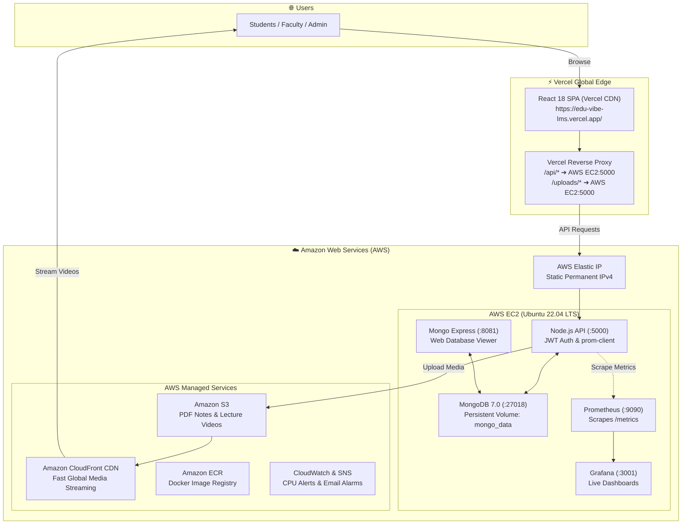

<p align="center">
  
</p>

# 🎓 EduVibe - Next-Gen Academic & Learning Management Portal

[](https://edu-vibe-lms.vercel.app/)
[](https://aws.amazon.com/)
[](https://www.terraform.io/)
[](https://www.docker.com/)
[](https://react.dev/)
[](https://nodejs.org/)
[](https://www.mongodb.com/)
[](https://prometheus.io/)

---

## 🚀 View Live Site

The project is live and accessible online:

[](https://edu-vibe-lms.vercel.app/)

🔗 **[Live Website](https://edu-vibe-lms.vercel.app/)**

---

## 📌 Project Overview

**EduVibe** is a modern, full-stack Academic & Learning Management Portal built with **React 18**, **Node.js**, **Express**, and **MongoDB 7.0**. It simplifies academic operations with three role-based dashboards:

- 👨‍🎓 **Students**: Watch lecture videos, download notes, take auto-graded quizzes, submit assignments, and track attendance (with 75% minimum warning alerts).
- 👩‍🏫 **Faculty**: Create courses, upload syllabus PDFs and video lectures, record daily attendance, create timed quizzes, and grade homework.
- 🛡️ **Admin**: Review analytics KPIs, approve new faculty registrations, and manage all users.

The frontend is served globally via **Vercel Edge**, while the backend, database, and telemetry run on **AWS EC2** provisioned automatically with **Terraform**.

> 📖 **Full Engineering Details**: See [`documentation.txt`](documentation.txt) for the complete architecture guide and step-by-step build manual.

---

## 🌐 Live Project Endpoints

| Service | Provider | URL | Notes |
| :--- | :--- | :--- | :--- |
| 🎓 **Live Web Portal** | **Vercel** | [https://edu-vibe-lms.vercel.app/](https://edu-vibe-lms.vercel.app/) | Production React SPA (Global Edge) |
| ⚡ **Live Production API** | **Render** | [https://eduvibe-lms-backend-api.onrender.com/api/health](https://eduvibe-lms-backend-api.onrender.com/api/health) | 24/7 Live PaaS API + Resend OTP Email |
| ☁️ **AWS Backend API** | **AWS EC2** | `http://<YOUR_AWS_PUBLIC_IP>:5000/api/health` | Containerized Express API on EC2 |
| 📊 **Prometheus Metrics**| **Render / AWS** | `https://eduvibe-lms-backend-api.onrender.com/metrics` | Real-time API telemetry metrics |
| 📈 **Grafana Dashboard** | **AWS EC2** | `http://<YOUR_AWS_PUBLIC_IP>:3001` | Live performance telemetry dashboard |

> *(For AWS endpoints, replace `<YOUR_AWS_PUBLIC_IP>` with your live EC2 Public IP or run `terraform output`).*

---

## 🏗️ System Architecture



### How It Works:
1. **Frontend Delivery**: Vercel serves the React SPA globally with zero latency.
2. **Smart API Routing**: `frontend/vercel.json` proxies all `/api/*` and `/uploads/*` requests to our AWS Elastic IP on port 5000. This completely avoids CORS and mixed-content issues.
3. **Authentication**: Passwords are encrypted with Bcrypt. Logins return a signed JSON Web Token (JWT) that authorizes role-based dashboard access.
4. **Media Streaming**: Lecture notes and videos upload to S3 and stream worldwide through Amazon CloudFront CDN.
5. **Monitoring**: Node.js exports `/metrics`, Prometheus collects them every 5s, and Grafana displays live visual charts.

---

## ☁️ AWS Cloud Services Used

| Service | Resource Name | What It Does In This Project |
| :--- | :--- | :--- |
| **1. Amazon EC2** | `aws_instance.eduvibe_server` | Runs the Docker engine with our API, MongoDB, and monitoring containers on Ubuntu 22.04 LTS (`t2.micro`). |
| **2. AWS Elastic IP** | `aws_eip.eduvibe_eip` | Provides a permanent static public IP so server restarts never break Vercel's proxy connection. |
| **3. Amazon S3** | `aws_s3_bucket.eduvibe_storage` | Secure cloud storage for lecture PDFs and videos with AES-256 encryption. |
| **4. Amazon CloudFront** | `aws_cloudfront_distribution.s3_distribution` | High-speed global CDN that caches and streams videos/PDFs with low latency. |
| **5. Amazon ECR** | `aws_ecr_repository` | Private Docker registry to store versioned images for automated deployments. |
| **6. Amazon CloudWatch** | `aws_cloudwatch_metric_alarm` | Monitors server health and triggers an alarm if CPU usage exceeds 85%. |
| **7. Amazon SNS** | `aws_sns_topic.alerts` | Sends instant alert emails to administrators when CloudWatch alarms trigger. |
| **8. AWS IAM & Security Groups** | `aws_security_group.eduvibe_sg` | Manages least-privilege cloud permissions and acts as a firewall for open ports (80, 5000, 8081, 9090, 3001, 22). |

---

## 🚀 Three Ways to Run & Deploy

```text
┌─────────────────────────────────────────────────────────────────────────────┐
│                      CHOOSE YOUR DEPLOYMENT METHOD                          │
├─────────────────────┬──────────────────────┬────────────────────────────────┤
│ 1. Local Dev (npm)  │ 2. Docker Compose    │ 3. AWS + Vercel Cloud          │
├─────────────────────┼──────────────────────┼────────────────────────────────┤
│ • Fast hot reload   │ • 1-command startup  │ • Production deployment        │
│ • Vite + Nodemon    │ • Runs all 6 tools   │ • Terraform automated infra    │
│ • Local Mongo DB    │ • Persistent volumes │ • Edge CDN + AWS Elastic IP    │
└─────────────────────┴──────────────────────┴────────────────────────────────┘
```

---

### 💻 Method 1: Local Development (Bare-Metal / npm)

Best for active coding and quick testing with instant hot reload.

#### 1. Start MongoDB
Make sure MongoDB is running on your machine (Port `27017`), or run:
```bash
docker compose up -d mongo
```

#### 2. Start Backend API (Terminal 1)
```powershell
cd backend
npm install
npm run dev
```
*Backend runs on `http://localhost:5000` (connects to MongoDB).*

#### 3. Start Frontend (Terminal 2)
```powershell
cd frontend
npm install
npm run dev
```
*Open `http://localhost:5173` in your browser (Vite automatically proxies API calls to port 5000).*

---

### 🐳 Method 2: Docker Container Deployment (Docker Compose)

Best for running the complete isolated stack in one simple command.

```bash
# Start core application (Frontend, Backend, MongoDB, Mongo Express):
docker compose up -d

# OR Start application + Prometheus & Grafana monitoring:
docker compose --profile monitoring up -d
```

**Local Docker URLs:**
- 🎓 **Web Portal**: [http://localhost:3005](http://localhost:3005)
- 🔌 **Backend API**: [http://localhost:5000/api/health](http://localhost:5000/api/health)
- 🍃 **MongoDB GUI**: [http://localhost:8081](http://localhost:8081)
- 📊 **Prometheus**: [http://localhost:9090](http://localhost:9090)
- 📈 **Grafana**: [http://localhost:3001](http://localhost:3001)

```bash
# To stop containers (data is saved in Docker volumes):
docker compose --profile monitoring down
```

---

### ☁️ Method 3: Cloud Production Deployment (AWS + Vercel)

Our live production deployment combining Vercel's global CDN with AWS cloud infrastructure.

#### Step 1: Provision AWS with Terraform (~2 minutes)
```bash
cd devops/terraform
terraform init
terraform apply -auto-approve
```
*Creates EC2, Elastic IP, S3, CloudFront, ECR, CloudWatch, and Security Groups.*

#### Step 2: Deploy Frontend on Vercel
1. Import repository to Vercel (Root Directory: `frontend`, Preset: `Vite`).
2. `frontend/vercel.json` automatically routes `/api/*` to the AWS Elastic IP.
3. Access live: **[https://edu-vibe-lms.vercel.app/](https://edu-vibe-lms.vercel.app/)**

#### Step 3: Run Containers on AWS EC2
```bash
ssh -i <your-key.pem> ubuntu@<YOUR_AWS_ELASTIC_IP>
git clone https://github.com/ajaygangwar945/EduVibe-LMS.git
cd EduVibe-LMS
docker compose --profile monitoring up -d
```

#### Cost Protection ($0 / Free Tier):
- Pause server when not in use: `aws ec2 stop-instances --instance-ids <INSTANCE_ID>`
- Destroy cloud resources when finished: `cd devops/terraform && terraform destroy -auto-approve`

---

## 🔑 Default Demo Accounts

The database comes pre-seeded with test accounts:

| Role | Email | Password | Access Capabilities |
| :--- | :--- | :--- | :--- |
| **System Admin** | `admin@eduvibe.com` | `admin123` | Approve faculty, manage users, view system KPIs |
| **Faculty** | `robert.smith@eduvibe.com` | `password123` | Create courses, mark attendance, upload videos/notes, create quizzes |
| **Student** | *(Self-Register)* | *(Your Password)* | Click **Register as Student** on login page (gets ID `STU-2026-XXXX`) |
| **Mongo Express GUI** | `http://<YOUR_AWS_ELASTIC_IP>:8081` | `admin` | *(Configured in `.env`)* |
| **Grafana Analytics** | `http://<YOUR_AWS_ELASTIC_IP>:3001` | `admin` | *(Configured in `.env`)* |

---

## 📁 Repository Structure

```text
EduVibe/
├── assets/
│   └── eduvibe-banner.jpg      # Custom AI-generated hero banner image
│
├── frontend/                   # React 18 Frontend (Vite)
│   ├── src/
│   │   ├── pages/             # Login, Student, Faculty & Admin Dashboards
│   │   ├── context/           # AuthContext (JWT session management)
│   │   ├── App.jsx            # Protected routes & app layout
│   │   └── index.css          # Glassmorphism design tokens & styles
│   ├── vercel.json            # Vercel deployment & API reverse-proxy rewrites
│   ├── Dockerfile             # Multi-stage Nginx container build
│   └── nginx.conf             # Nginx reverse proxy config
│
├── backend/                    # Node.js Express Backend
│   ├── models/                # User, Course, Attendance, Quiz, Assignment
│   ├── routes/                # auth.js, student.js, faculty.js, admin.js
│   ├── middleware/            # JWT verification & Multer file uploads
│   ├── server.js              # Express app + /metrics Prometheus endpoint
│   ├── Dockerfile             # Lightweight Node.js Alpine container
│   └── uploads/               # Persistent uploaded PDFs and videos
│
├── .github/
│   └── workflows/
│       └── deploy.yml         # GitHub Actions CI/CD with Dynamic EC2 IP Discovery
│
├── devops/
│   ├── terraform/             # AWS Infrastructure as Code (EC2, S3, CloudFront, ECR, IAM)
│   ├── k8s/                   # Kubernetes manifests (Deployments, Services, PVC)
│   └── monitoring/            # Prometheus scrape config & Grafana dashboards
│
├── .dockerignore              # Docker build exclusions
├── .gitignore                 # Git ignore rules for secrets and node_modules
├── docker-compose.yml         # Main root multi-container configuration
├── documentation.txt          # Complete in-depth technical manual & engineering guide
└── README.md                  # Main project overview & quickstart guide
```

---

## 👤 Author & Academic Details

- **Ajay Gangwar** - [GitHub Profile](https://github.com/ajaygangwar945)
- **Project**: EduVibe - Next-Gen Academic & Learning Management Portal
- **Course**: INT 377 - Cloud & DevOps Architecture (SEM 6)
